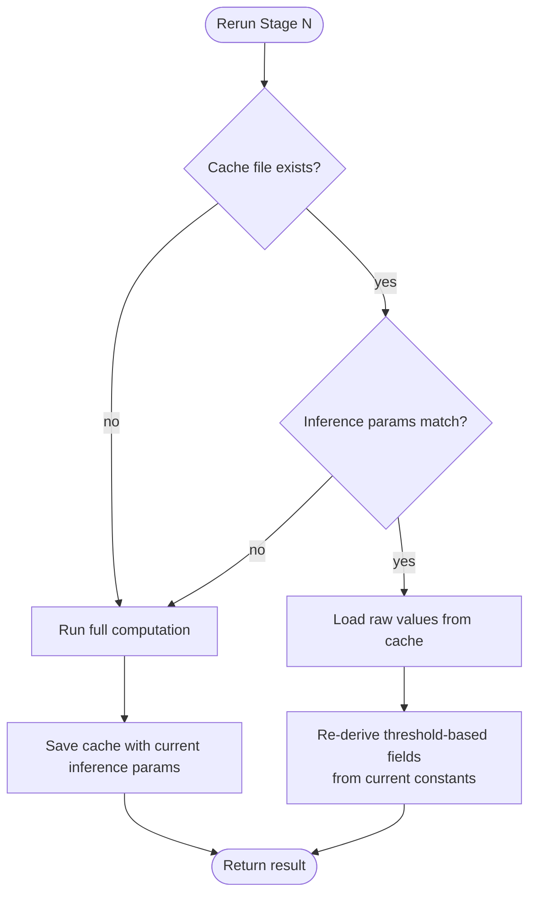

# Pipeline Architecture

Deep explanation of what each stage does, why it does it, and how the pieces fit together.

For installation and running, see [README.md](README.md).

---

## Table of Contents

- [The Problem](#the-problem)
- [Design Constraints](#design-constraints)
- [High-Level Flow](#high-level-flow)
- [Stage-by-Stage Deep Dive](#stage-by-stage-deep-dive)
  - [Stage 1: Video Discovery](#stage-1-video-discovery)
  - [Stage 2: Download & Prepare](#stage-2-download--prepare)
  - [Stage 3: Local Pre-Filter](#stage-3-local-pre-filter)
  - [Stage 4: AI Crowd Scoring](#stage-4-ai-crowd-scoring)
  - [Stage 6: Segment Builder](#stage-6-segment-builder)
  - [Stage 7: Crowd Count](#stage-7-crowd-count)
  - [Stage 8: Output & Analytics](#stage-8-output--analytics)
- [Data Contract Chain](#data-contract-chain)
- [Caching Strategy](#caching-strategy)
- [Deviations from the Reference Architecture](#deviations-from-the-reference-architecture)
- [Cost Breakdown](#cost-breakdown)

---

## The Problem

Given a search query like *"Times Square New Year crowd"*, find timestamped segments of **high crowd density** inside real YouTube videos and export them in a form that downstream tools (dashboards, editors, review UIs) can consume.

"High crowd density" is subjective — a stadium at half capacity can have the same absolute person count as a packed subway platform but very different density. The pipeline needs both a numeric signal (how many people?) and a semantic signal (does this *feel* crowded?).

---

## Design Constraints

1. **Free tier only by default.** No cloud spend unless the user explicitly opts in.
2. **Interruptible.** Eight sequential stages must survive Ctrl-C, network blips, and API outages. Every expensive step is cached and idempotent.
3. **Tuneable without re-running expensive stages.** Changing the "what counts as a crowd" threshold should not trigger another Gemini bill.
4. **Standalone stages.** Each stage runs independently for debugging, with its own CLI and cache.

Every design choice below follows from these four constraints.

---

## High-Level Flow


Colors:
- 🟦 Blue — external services (paid or rate-limited)
- 🟩 Green — local ML inference
- 🟧 Orange — Gemini (the only intentional cloud dependency)
- 🟪 Purple — pure Python computation

Stage 5 from the reference doc is intentionally missing. The Stage 7 slot here counts people; the reference doc's Stage 7 (enrichment) is deferred. See [Deviations](#deviations-from-the-reference-architecture).

---

## Stage-by-Stage Deep Dive

### Stage 1: Video Discovery

**File:** `stage1_search.py`
**Input:** search query string
**Output:** `list[DiscoveredVideo]` + `discovery.json`

#### What it does

Queries the YouTube Data API v3 for videos matching a phrase, returns a ranked list with metadata (title, duration, view count, channel, thumbnail).

#### Why it exists

We need a source of candidate videos. YouTube's own search relevance is very good — building our own ranker would waste effort. The Data API is a stable public interface, unlike unofficial scrapers which break unpredictably.

#### How it works

```
              ┌──────────────────────────┐
  query ────▶ │ GET /youtube/v3/search   │ ── 100 units ──▶ [video IDs]
              └──────────────────────────┘
                              │
                              ▼
              ┌──────────────────────────┐
              │ GET /youtube/v3/videos   │ ── 1 unit ─────▶ [full metadata]
              │      (batched, up to 50) │
              └──────────────────────────┘
                              │
                              ▼
              Filter: 30s ≤ duration ≤ 3600s
              Filter: liveBroadcastContent != "live"|"upcoming"
                              │
                              ▼
              Save discovery.json
```

#### Design choices

- **Two calls, not one.** `search.list` returns only lightweight snippets (no duration). We batch a single `videos.list` for all IDs to get the full metadata — 1 unit total, no matter how many videos.
- **stdlib `urllib`, no `google-api-python-client`.** The client library is ~60 MB with transitive deps. We're calling two REST endpoints — `urllib.request` is fine.
- **Duration filter.** Excludes 15-second shorts (no crowd context) and multi-hour livestream VODs (would blow the Gemini budget).
- **Live-broadcast filter.** Live streams have `duration=0` and can't be reliably downloaded.

#### Cost

101 quota units per query. Free tier is 10,000/day → **~99 queries/day**.

---

### Stage 2: Download & Prepare

**File:** `stage2_download_prepare.py`
**Input:** list of YouTube URLs
**Output:** `list[VideoData]` + on-disk MP4 + JPEG frames

#### What it does

Downloads each video's MP4 via yt-dlp; slices it into JPEG frames at 1 fps via FFmpeg.

#### Why it exists

- Gemini can't stream YouTube URLs — it needs local files (either full videos via File API or per-frame images).
- 1-fps sampling reduces multi-GB videos to a few hundred ~100 KB JPEGs — small enough to upload quickly, dense enough to catch crowd events shorter than the sampling interval.

#### How it works

```
URL
 │
 ▼
_extract_video_id(url)  ────▶  cache hit?  ──yes──▶  return VideoData
 │                                  │
 no match                           no
 │                                  │
 ▼                                  ▼
yt-dlp probe (network)      yt-dlp download
 │                          (best mp4)
 ▼                                  │
video_id                            ▼
 │                          ffmpeg -vf "fps=1,scale=1280:-1"
 ▼                          -q:v 2 frames/%06d.jpg
cache hit?                          │
 │                                  ▼
yes ──▶ return               write .stage2_done
                             (sentinel: extraction succeeded)
```

#### Design choices

- **Local video-ID parsing first.** Cache hits skip yt-dlp entirely — no network on reruns. Only unrecognized URL formats fall back to a network probe.
- **`.stage2_done` sentinel.** An interrupted FFmpeg leaves partial frames on disk. Without a sentinel, the cache-check would see frames and lie. The empty sentinel file guarantees "if `.stage2_done` exists, the extraction completed."
- **`-c copy` not used here.** FFmpeg re-encodes to JPEG — needed for the width-1280 rescale.
- **1280 px width, 1 fps.** Empirically good enough for crowd density; keeps JPEGs at ~50–100 KB for fast Gemini upload.
- **720p download cap (`MAX_HEIGHT`).** Every format alternative in the yt-dlp chain is height-capped, with `format_sort: ["res:720"]` holding the last-resort `best` down too — an uncapped tail would let any upload lacking an m4a audio stream fall through to 4K. Since frames are rescaled to 1280 px and YOLO sees 640 px, the extra pixels buy nothing: a 30-minute upload is ~5.7 GB at 2160p versus ~0.7 GB at 720p.
- **Graceful failure.** Private or geo-blocked videos log a warning and return `None`. The batch continues.

---

### Stage 3: Local Pre-Filter

**File:** `stage3_prefilter.py`
**Input:** `list[VideoData]`
**Output:** `list[PrefilteredVideo]` with per-frame person counts

#### What it does

Runs YOLOv8-nano on every extracted frame, counts persons, marks frames with count < `PERSON_COUNT_MIN` (default 5) as "won't reach Gemini."

#### Why it exists

Gemini is the pipeline's rate limit (15 RPM free tier). Many frames don't need Gemini's judgment — an empty street or a close-up of a single face is clearly not a crowd. A fast local classifier can filter these out before they consume Gemini quota.

#### Why local YOLO, not Google Cloud Vision

The reference architecture uses Google Cloud Vision API here. **Cloud Vision's free tier is 1,000 units/month.** At ~360 units per video, we'd exceed the free tier within ~3 videos. Local YOLO has none of those constraints:

| | Cloud Vision | Local YOLOv8n |
|---|---|---|
| Free tier | 1,000 units/month | Unlimited |
| Cost after that | $1.50 per 1K units | $0 |
| Latency | ~200 ms + network | ~20 ms |
| Model size | N/A (cloud) | 6 MB |
| Accuracy on person detection | Excellent | Very good |

For counting people in a frame, YOLOv8n is more than accurate enough. The trade-off in edge-case accuracy is invisible next to Gemini's downstream reasoning.

#### How it works

```
Every JPEG in frames/           batch of 32 at a time
        │                                   │
        ▼                                   ▼
YOLOv8n forward pass ──▶ boxes with class=person, conf≥0.3
        │
        ▼
FrameScore(path, timestamp, person_count, passes_filter)
        │
        ▼
passes_filter = (person_count >= PERSON_COUNT_MIN)
        │
        ▼
prefilter.json  (cached)
```

#### Design choices

- **Lazy import of ultralytics.** `from ultralytics import YOLO` moved inside `_get_model()`. Prevents forcing anyone who imports `FrameScore` (a plain dataclass) to install ~500 MB of torch.
- **Threshold re-derived at load.** The cache stores raw `person_count` per frame — a function of `YOLO_CONFIDENCE` and the model weights. `passes_filter` is *computed at cache-load time* from the current `PERSON_COUNT_MIN`. This means tuning the threshold doesn't require re-inference.
- **Cache invalidates on `confidence` or model change.** Both affect the raw counts. Anything else (threshold, batch size) is post-processing and preserved.

#### Result

Typically **60–80% frame reduction** before Gemini. A 3-minute video at 1 fps goes from 180 raw frames to ~40 candidate frames.

---

### Stage 4: AI Crowd Scoring

**File:** `stage4_gemini_score.py`
**Input:** `list[PrefilteredVideo]`
**Output:** `list[ScoredVideo]` with per-frame crowd scores 1–10

#### What it does

Sends each candidate frame to Gemini 3.5 Flash with a structured prompt. Gets back a JSON object with `score` (1–10), a `vantage` (`ground` / `elevated` / `aerial` / `unknown`, judged from geometry — viewing angle, sky visible, tops of heads — independent of how close the crowd is) and one-sentence `reasoning`. Stage 6 uses the vantage to keep only elevated footage, so the gate stays cached and retunable for free.

#### Why Gemini, not just YOLO's count

YOLO can count people but doesn't understand density. Consider:

| Scenario | YOLO count | Actual density |
|----------|-----------|----------------|
| Stadium at half capacity, aerial shot | ~50 | Low |
| Packed subway platform, ground level | ~50 | Extreme |
| Wide crowd shot with 8 heads visible | 8 | Ambiguous |
| Concert front row, arms up | 12 | High |

A generative model with visual reasoning handles these correctly. It also handles aerial shots, low-light scenes, and wide-angle distortion — where a person detector might fail or overcount.

#### How it works

```
frame_path
   │
   ▼
read bytes ── image/jpeg part ────────┐
                                       │
prompt: "Rate the crowd density..." ──┼──▶ Gemini 3.5 Flash
                                       │    (response_schema=CrowdScoreResponse)
                                       │
                                       ▼
                            CrowdScoreResponse(score=int, reasoning=str)
                                       │
                            resp.parsed is None?
                             /                 \
                          yes                    no
                           │                      │
                           ▼                      ▼
                     score=1 sentinel        clamp to [1, 10]
                           │                      │
                           └──────────┬───────────┘
                                      ▼
                            GeminiScore(frame, score, reasoning)
                                      │
                                      ▼
                       gemini_scores.json (checkpointed every 10 frames)
```

#### Design choices

- **Structured output via Pydantic schema.** Gemini's `response_schema=CrowdScoreResponse` guarantees a typed response — no regex parsing, no malformed-JSON bugs.
- **Rate-limited to 15 RPM by default.** Simple time-spacing (4 s between calls) matches free tier. Configurable via `--rpm` if you're on a paid tier.
- **Optional concurrency (`--workers`, default 1).** A call takes ~2 s, so a sequential loop cannot exceed ~30 RPM whatever `--rpm` says. With `--workers N`, a thread pool scores one video's frames at once while a lock-guarded limiter keeps the *global* call spacing at `60/rpm`. Results are re-sorted by timestamp, so output is identical to a sequential run. On quota exhaustion or a per-video error, queued frames are cancelled and in-flight ones still bank to the cache.
- **Exponential backoff on *transient* 429/5xx.** 5 attempts, 1s → 16s. Handles per-minute rate limits and blips without cascading a full-batch failure.
- **Terminal errors bail immediately (`_is_terminal`).** A spend cap, daily quota, suspended consumer or bad API key will not fix itself, so retrying burns 5 attempts × every remaining frame for nothing. These raise `QuotaExhausted` on the first attempt instead.
- **Two failure scopes, two behaviors.** A per-video fault (corrupt frame, unexpected error) checkpoints what scored, returns `None`, and the batch carries on without that video — the same convention Stage 2 uses. `QuotaExhausted` is account-wide, so `run_stage4` ends the batch, returns the videos that finished, and reports how many were left unscored. Either way the partial `gemini_scores.json` survives, so a rerun resumes frame-by-frame rather than restarting the video.
- **`resp.parsed is None` handled.** Safety-blocked or malformed responses would normally crash `.score`. We return a floor-score sentinel (score=1, reasoning=`"no parsed response (finish=...)"`), so the frame drops out of the high-density set without stopping the pipeline.
- **Score clamped to [1, 10] post-parse.** Belt-and-suspenders against a rogue model response.
- **Incremental cache saves.** Every 10 frames, the full scores JSON is rewritten. Ctrl-C in the middle of an hour-long batch loses at most 10 frames' worth of work.
- **Temperature 0.2.** Low enough for repeatable scoring; not zero because generative models still vary ±1–2 points even with temp=0.

---

### Stage 6: Segment Builder

**File:** `stage6_segment_builder.py`
**Input:** `list[ScoredVideo]`
**Output:** `list[VideoSegments]` — merged time ranges

#### What it does

Merges consecutive high-density frames into time segments. A single high-score frame isn't useful; a range like "0:45 → 1:52 was densely packed" is.

A segment never crosses a scene cut. Many uploads are edited montages with a cut every 1–3 s, and a 1 fps sample tells you nothing about the shot next to it. Before this rule, a clip could run from a drone shot into a ground-level close-up, a title card or a fade to black.

#### How it works

```
gemini_scores  (sorted by timestamp)
      │
      ▼
Filter: crowd_score >= CROWD_THRESHOLD (default 7)
      │
      ▼         time
      ┌──────────────────────────────────────────▶
      │  ●●●     ●●        ●●●●         ●
      │  8 9 8   7 8       9 8 8 7      7
      │  └─┬─┘   └┬┘       └──┬──┘      └┬┘
      │   grp1   grp2       grp3         grp4
      │      gap 4s  gap 6s      gap 12s
      │
      ▼
Group where consecutive gap <= MIN_SEGMENT_SECS (default 3s)
  AND no shot boundary between them (cuts + black intervals, shots.json)
      │
      ▼
For each group: aggregate
      ├─ start = max(first.timestamp, shot start)
      ├─ end   = min(last.timestamp + (1/fps), shot end)
      ├─ avg / peak crowd_score
      ├─ avg / peak person_count
      ├─ yt_link = url + &t={start}s
      ├─ reasoning_samples[:3]
      └─ peak_timestamp (best hit → Stage 8 poster)
      │
      ▼
Drop segments shorter than MIN_CLIP_SECS (default 1.5s)
      │
      ▼
segments.json
```

**Shot detection** is one FFmpeg pass per video, about 2 s per minute of 720p: `blackdetect` plus the `select` filter's per-frame scene score, on a 320 px copy. The result is cached in `shots.json`.

```
scene score
   0.6 |     #                     # #       cut = one-frame spike that is
       |     #                     # #             >= SCENE_MIN_SCORE (0.2) AND
   0.2 |     #   ##########        # #             >= 2.5 x median(neighbours)
       |_____#___##########________#_#____
       +-----------------------------------> time
            cut   fast pan (no cut)  cuts around a still title card
```

#### Design choices

- **Gap-inclusive grouping.** `gap <= MIN_SEGMENT_SECS` (not `<`). At 1 fps, this tolerates 2 dropped frames between hits — enough to bridge a YOLO or Gemini miss without smearing across a genuine low-density stretch.
- **End extends by `1/fps`.** A hit at t=112 with fps=1 represents 112.0–113.0. Extending `end` gives ranges you can hand to a video editor without an off-by-one. FFmpeg's `fps=1` filter actually samples the middle of that window (measured: t + 0.46–0.48 s), so a frame's shot is the one containing `t + 0.5/fps`.
- **Cuts are spikes measured against their neighbours, not a fixed threshold.** A fast pan scores 0.2–0.3 for dozens of frames, while a cut spikes once. A fixed 0.3 threshold missed real cuts that scored 0.27 and would still flag pans in noisy footage. This is the idea behind PySceneDetect's AdaptiveDetector, done with FFmpeg so no dependency is added. Two details:
  - The neighbour level is a **median**, so the cut into a still title card can't hide the cut out of it.
  - It is taken over frames that **changed**: 60 fps uploads of 24/25 fps footage repeat frames, which score ~0 and would otherwise make every moving frame look like a spike.
- **The ratio is 2.5, not PySceneDetect's 3.0.** A false cut only splits a good clip in two, while a missed cut leaves another shot inside it. Tuned on 17 local videos and the Puri montage clips.
- **Dissolves and within-shot changes are not caught.** Crossfades never spike. An FPV drone that dips from rooftop height to head height without a cut stays one shot, and 1 fps scoring can't see a sub-second vantage change.
- **`MIN_CLIP_SECS` drops one-frame flashes.** A single sampled frame is weak evidence: in montages these were archival stills and title cards that Gemini scored 8.
- **`crowd_threshold` parameterized.** The default `CROWD_THRESHOLD` (imported from Stage 4) is overridable per call. This is what `tune.py` uses to try new thresholds against cached scores — no re-inference needed.
- **Segments aren't cached; shots are.** Segment building is deterministic and fast (milliseconds), so it reruns every call. Shot detection decodes the whole video, so `shots.json` stores the raw candidates (time, score, neighbour median) and re-derives cuts from the current `SCENE_MIN_SCORE` / `SCENE_SPIKE_RATIO` at load time. `--ignore-cuts` (Stage 6, `tune.py`) restores the old behaviour.

---

### Stage 7: Crowd Count

**File:** `stage7_crowd_count.py`
**Input:** `list[VideoSegments]`
**Output:** `list[CountedVideo]` — the same segments plus an estimated people count for each

#### What it does

Estimates how many people each segment shows. Stage 3's YOLO counts can't serve: a detector needs a mostly visible body, and from a drone a dense crowd is thousands of 5-pixel heads. YOLOv8n reports 0 for frames that hold over a thousand people.

#### How it works

```
frames inside each segment (sample moment t + 0.5/fps in [start, end))
      │
      ▼
DM-Count (VGG19 + density head, UCF-QNRF weights), native 1280 px input
      │      density map: each pixel = expected people there; sum = count
      ▼
crowd_counts.json   {frame name: count}, keyed by model + input scale
      │
      ▼
per segment: crowd_count_avg (mean over frames), crowd_count_peak (max frame)
```

#### Design choices

- **Density regression, not detection.** This is the standard approach for dense crowds since 2016. The model is DM-Count (Wang et al., NeurIPS 2020, MIT) with weights from the LWCC project, built on the `torchvision` already installed for YOLO, so no new pip dependency. The 86 MB weights download once into `weights/`, which is gitignored, and load with `weights_only=True` because they come from the internet.
- **UCF-QNRF weights over ShanghaiTech-A, at native size.** Tested on this project's aerial frames:
  - QNRF's counts mostly held steady when frames were upscaled 1.5× and 2×; SHA's drifted.
  - A hand-counted patch of about 20–30 people read 23 with QNRF; SHA reads about 40% lower.
  - Upscaling moved QNRF's counts by -14% to +20% with no consistent direction, so native size is kept: it's the cheapest, and the numbers are good to about ±20%.
- **Only frames inside segments.** That's what the dataset reports. It's roughly 0.1 s per frame on a GPU and 2 s on CPU (5 s for portrait frames), well under the 4 s per frame that Stage 4 already spends at 15 RPM.
- **Cached per frame; aggregates re-derived.** As in Stages 3 and 4, the inference result is cached and invalidated on model or scale change, while avg/peak per segment are recomputed. Re-segmenting with `tune.py` only counts frames it hasn't seen.
- **Known failure: colour powder.** Holi and gulal-heavy processions are outside the training data. Dense powdered crowds read 7–80. The same disagreement also exposes bad clips, such as frames that are a pink cloud with almost no visible people, which Gemini still scored 8. Sort `manifest.csv` by `crowd_count_avg` to review the lowest clips.
- **Optional.** `--no-count` (Stages 1 and 8, `tune.py`) skips it. If the model can't load, for example with no network on the first weights download, the batch continues with blank counts.

---

### Stage 8: Output & Analytics

**File:** `stage8_output.py`
**Input:** `list[VideoSegments]`
**Output:** `results.json`, `segments.csv`, optional per-segment MP4 clips

#### What it does

Aggregates per-video segments into batch-level files. Optionally extracts an MP4 clip per segment via FFmpeg.

#### Why separate from Stage 6

Stage 6 produces per-video `segments.json`. Stage 8 produces the batch-level output tools actually consume. Splitting them keeps each concern focused:
- Stage 6 = computation
- Stage 8 = serialization + physical clip extraction

#### How it works

```
list[VideoSegments]
        │
        ├──▶ results.json  (JSON: matches doc schema, includes signal_sources)
        │
        ├──▶ segments.csv  (flat, one row per segment, pandas-ready)
        │
        ├──▶ (optional) clips/{video_id}_{start}-{end}.mp4
        │
        └──▶ (optional, --dataset DIR --location SLUG)
               DIR/<location>/<vantage>/IND_<CODE>_NNNN/{clip.mp4, poster.jpg, metadata.json}
               DIR/manifest.csv
```

Clips are re-encoded to H.264 (CRF 20, bitrate capped at 2× the source), cut frame-accurately.

#### Design choices

- **Two artifact formats.** JSON is nested and machine-readable; CSV is flat and spreadsheet-friendly. Different consumers, different formats.
- **Re-encode, not `-c copy`.** Stream copy has to start at the previous keyframe, which in an edited upload is usually the previous shot. Most players hide that lead-in via the MP4 edit list, but the frames are still in the file. Now that segments end exactly on cuts, the cut must be exact. It costs ~1 s per clip.
  - **Bitrate cap.** Plain CRF spent 3–6× YouTube's bitrate on reproducing its compression noise, so the bitrate is capped at 2× the source.
  - **Codec trade-off.** Most downloads are AV1/VP9, which H.264 needs about twice the bits to match. In return, clips play everywhere: AV1-in-MP4 doesn't on stock Windows.
- **Re-export replaces, IDs never repeat.** Exporting a video replaces that video's earlier assets at the same location, deleting the superseded folders. New IDs number on from the highest ID for that code already in `manifest.csv`. This covers rerunning a query, adding a second query for a location, and two locations sharing a 3-letter code (`delhi-railway-station` and `mumbai-railway-station` are both `RAI`). Before this change, numbering restarted at `0001` each run: clip folders were overwritten while the manifest kept the old rows.
- **Poster = the segment's best qualifying hit.** Stage 6 records it in `peak_timestamp`. Previously it was the best-scoring frame anywhere in the time range, which could be a ground-level frame the vantage gate had rejected.
- **`signal_sources: ["gemini", "yolo"]`.** Honest labeling of what actually contributed. Reference doc lists `["gemini", "video_intelligence", "audio"]`; we don't have those. When Stage 5 or 7 gets built, extend `SIGNAL_SOURCES` in one place.
- **No caching.** Output artifacts overwrite every run. Tuning upstream should always produce fresh outputs.

---

## Data Contract Chain

Every stage produces a dataclass that **composes** the previous stage's output. No inheritance, no mutation — pure wrapping.

```
DiscoveredVideo          [Stage 1] — search hit
├─ video_id, url, title, duration_secs, view_count, channel, ...

    │  (extract .url for Stage 2)
    ▼

VideoData                [Stage 2] — downloaded + extracted
├─ video_id, url, title, duration
├─ video_path, frames_dir, frame_paths
└─ metadata (yt-dlp info + extraction params)

    │
    ▼

PrefilteredVideo         [Stage 3]
├─ .video: VideoData                    ◀── wraps
├─ .frame_scores: list[FrameScore]         (YOLO count per frame)
└─ .candidate_frames                       (subset that passed the filter)

    │
    ▼

ScoredVideo              [Stage 4]
├─ .prefiltered: PrefilteredVideo       ◀── wraps
├─ .gemini_scores: list[GeminiScore]       (Gemini score per frame)
└─ .high_density_frames                    (subset with score >= CROWD_THRESHOLD)

    │
    ▼

VideoSegments            [Stage 6]
├─ .scored: ScoredVideo                 ◀── wraps
├─ .segments: list[Segment]                (merged time ranges)
└─ .video (shortcut walks scored → prefiltered → video)

    │
    ▼

CountedVideo             [Stage 7]
├─ .segmented: VideoSegments            ◀── wraps
├─ .segment_counts: list[SegmentCount | None]   (avg / peak people, aligned with segments)
└─ .video / .segments / .scored (shortcuts, so Stage 8 takes either type)
```

### Why composition, not inheritance

`PrefilteredVideo` is *not* "a `VideoData`" — it *has* a `VideoData` plus new fields. Composition:
- Preserves the original stage's data unchanged (safe reruns).
- Lets tests build partial states without satisfying inheritance chains.
- Makes the wrap direction explicit (`.scored.prefiltered.video`), which is greppable.
- Avoids diamond inheritance if Stage 5 (audio) ever gets added alongside Stage 4.

### Why derived properties, not stored fields

`candidate_frames` and `high_density_frames` are `@property` — recomputed on every access. This means:
- Changing the threshold and re-reading the property gives fresh results without rebuilding the dataclass.
- No stale-data bugs where the stored subset disagrees with the raw list.

---

## Caching Strategy

Every expensive stage writes a cache file next to `metadata.json`. The design principle:

> **Invalidate on inputs that affect output. Re-derive post-processing decisions at load time.**



| Cache file | Invalidates on | Re-derived at load |
|------------|----------------|--------------------|
| `.stage2_done` + `frames/` | absent = re-run | — |
| `prefilter.json` | `YOLO_CONFIDENCE`, `YOLO_MODEL` change | `passes_filter` from current `PERSON_COUNT_MIN` |
| `gemini_scores.json` | frame path added/removed | `is_high_density` from current `CROWD_THRESHOLD` |
| `crowd_counts.json` | `COUNT_MODEL`, `INPUT_SCALE` change | per-segment avg / peak from current segments |
| `shots.json` | `SHOT_DETECT_PARAMS` change | cut times from current `SCENE_MIN_SCORE`, `SCENE_SPIKE_RATIO` |
| `segments.json` | never — always recomputed | (fully derived from `gemini_scores.json` + `shots.json`) |

### What this buys us

Tuning `PERSON_COUNT_MIN` or `CROWD_THRESHOLD` is **free** — no re-inference, no Gemini calls. Only `YOLO_CONFIDENCE` or `YOLO_MODEL` force re-inference at Stage 3; only clearing `gemini_scores.json` forces re-scoring at Stage 4.

This is what `tune.py` (and the `/tune-threshold` slash command) exploit. They load cached Gemini scores, re-run Stage 6 and Stage 8 with new parameters, and produce a fresh `results.json` in seconds without touching the network. With `--dataset DIR --location SLUG`, `tune.py` also re-exports that location's dataset clips under the current rules.

---

## Deviations from the Reference Architecture

The `crowd_pipeline_v2_documentation.docx` describes a fully cloud-native pipeline. We deviate to stay free-tier viable.

```mermaid
flowchart TB
    subgraph Reference["Reference architecture (cloud-native, ~$6/video)"]
        R1[Search] --> R2[Download] --> R3[Video Intel + Cloud Vision] --> R4[Gemini] --> R5[STT + Captions] --> R6[Segment Merge] --> R7[Geocoding + NL API] --> R8[BigQuery + Looker]
    end

    subgraph Actual["Actual implementation (lean, ~$0/video on free tier)"]
        A1[Search] --> A2[Download] --> A3["YOLOv8n local"] --> A4[Gemini] --> A6[Segment Merge] --> A8[JSON + CSV]
    end

    style R3 fill:#ffcdd2
    style R5 fill:#ffcdd2
    style R7 fill:#ffcdd2
    style R8 fill:#ffcdd2
    style A3 fill:#c8e6c9
```



Red = removed / replaced. Green = local substitute.

| Stage | Reference | Actual | Reason |
|-------|-----------|--------|--------|
| 3 | Video Intelligence + Cloud Vision | **Local YOLOv8n** | Cloud Vision free tier caps at 1K units/month — exceeded within ~5 videos. YOLO runs unlimited on CPU. |
| 5 | Speech-to-Text + captions | **Dropped** (default off in reference too) | STT free tier is 60 min/month — insufficient at any scale. Crowd audio cues add little signal that visual scoring doesn't already catch. |
| 7 | Geocoding + Natural Language | **Deferred** (placeholder fields in JSON). The Stage 7 slot instead holds a **local crowd counter** (DM-Count) | Enrichment isn't core to crowd detection. A people estimate is, and YOLO can't provide one from height. |
| 8 | BigQuery + Looker Studio | **Local JSON + CSV** | Zero infrastructure. Pandas/DuckDB can query the same data. |

**Only Stage 4 (Gemini) is a paid dependency** — and it stays free at 15 RPM.

### If you want to add back the removed stages

- **Stage 5 (audio)** — extend `SIGNAL_SOURCES` in `stage8_output.py`, add a stage5 module that reads YouTube captions via yt-dlp (free) or STT (paid). Add `audio_cues` field to `Segment` in Stage 6.
- **Enrichment (reference Stage 7)** — populate `metadata["location"]` and `metadata["entities"]` in a new module between Stage 7 and Stage 8. Stage 8 already reads these fields and emits them in `results.json`.

The composition pattern means neither addition requires changes to existing stages.

---

## Cost Breakdown

### Per 3-minute video at 1 fps

```
                 free tier             paid tier
Stage 1        101 quota units       101 quota units
Stage 2        (local, free)         (local, free)
Stage 3        (local, free)         (local, free)
Stage 4        ~40 calls @ 15 RPM    ~40 calls @ 60 RPM
                = 3 min wait          = 40 sec wait
                = $0                  = ~$0.04
Stage 6        (local, free)         (local, free)
Stage 7        (local, free)         (local, free)
                ~2 s/frame CPU, 0.1 s GPU, segment frames only
Stage 8        (local, free)         (local, free)
─────────────────────────────────────────────────────
Total          3 min, $0             1 min, $0.04
```

### 30-video batch on free tier

- YouTube quota: 3,030 units (30% of 10K/day)
- Gemini calls: ~1,200 candidates → 80 min at 15 RPM
- Everything else: local, unlimited
- **Total cost: $0. Total time: ~90 minutes.**

### Where the free tier bottleneck is

**Gemini's 15 RPM is the primary constraint.** Every other free tier (YouTube quota, YOLO, FFmpeg, disk) has orders-of-magnitude more headroom. To scale beyond the free tier's throughput:
- Upgrade Gemini to paid tier (~$0.001 per call) and use `--rpm 60`
- Or use Gemini's Batch API (50% discount, async — not yet implemented here)

Estimating for your specific batch: use the `/cost-estimate` slash command, which reads actual observed YOLO pass rates from any cached `prefilter.json` files for more accurate projections.
